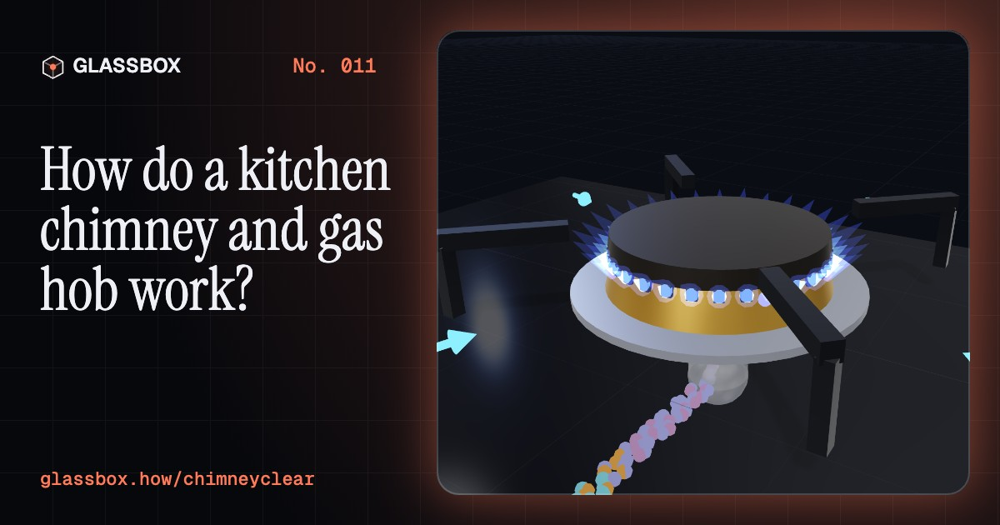
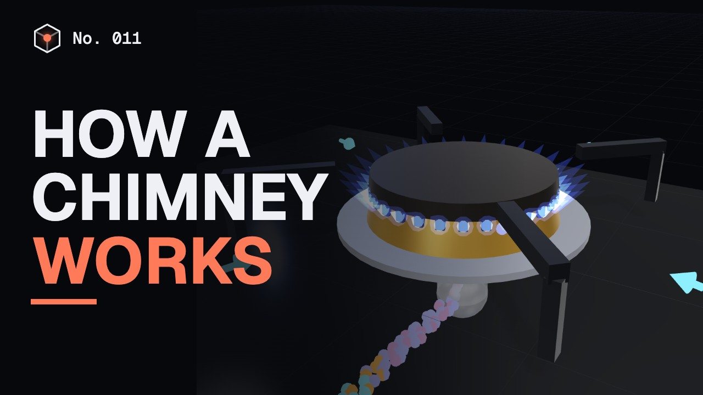
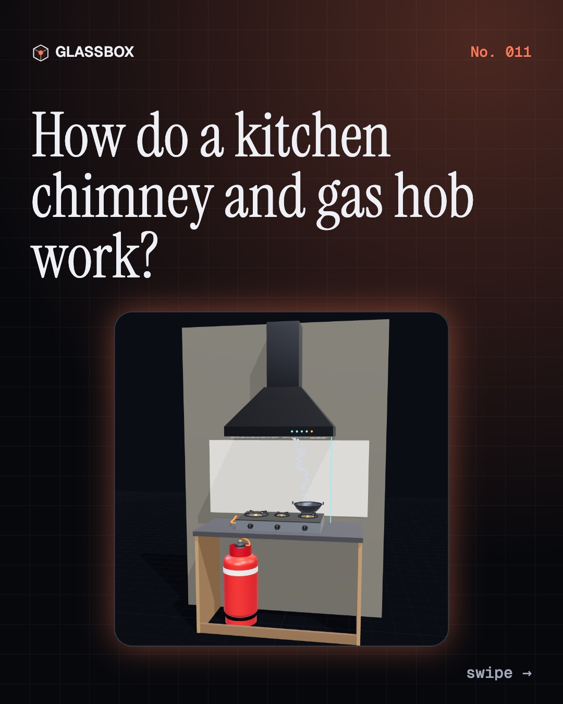
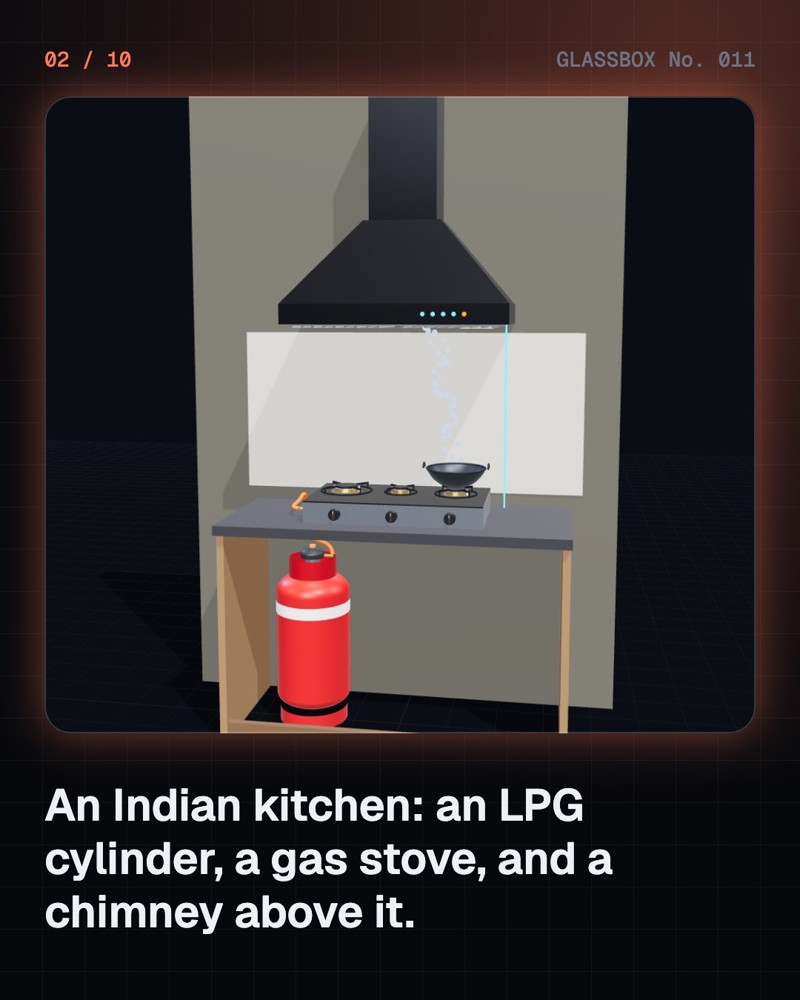
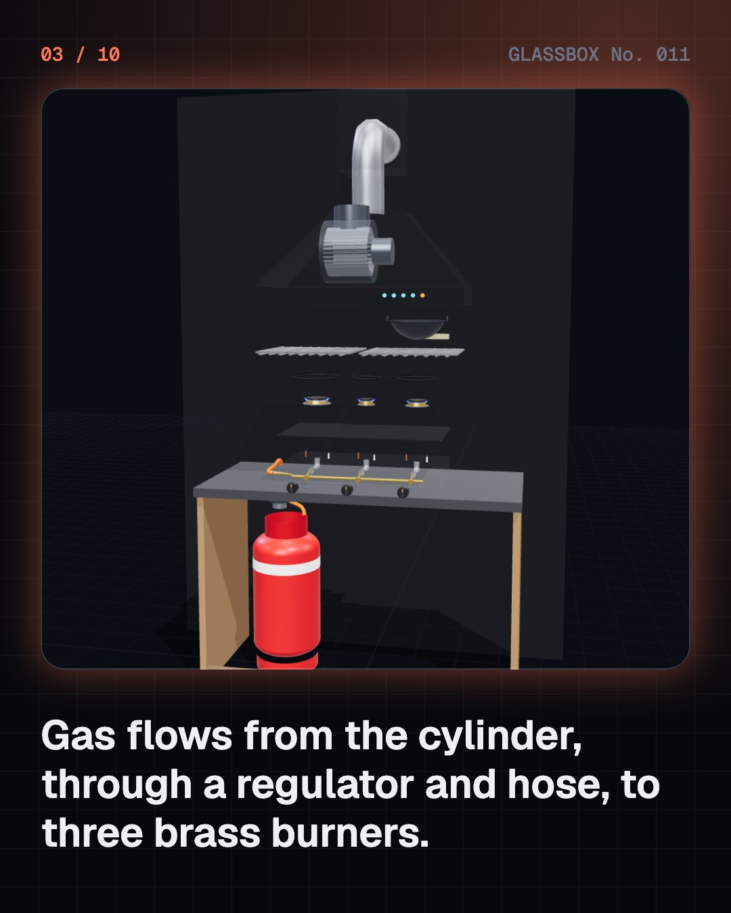
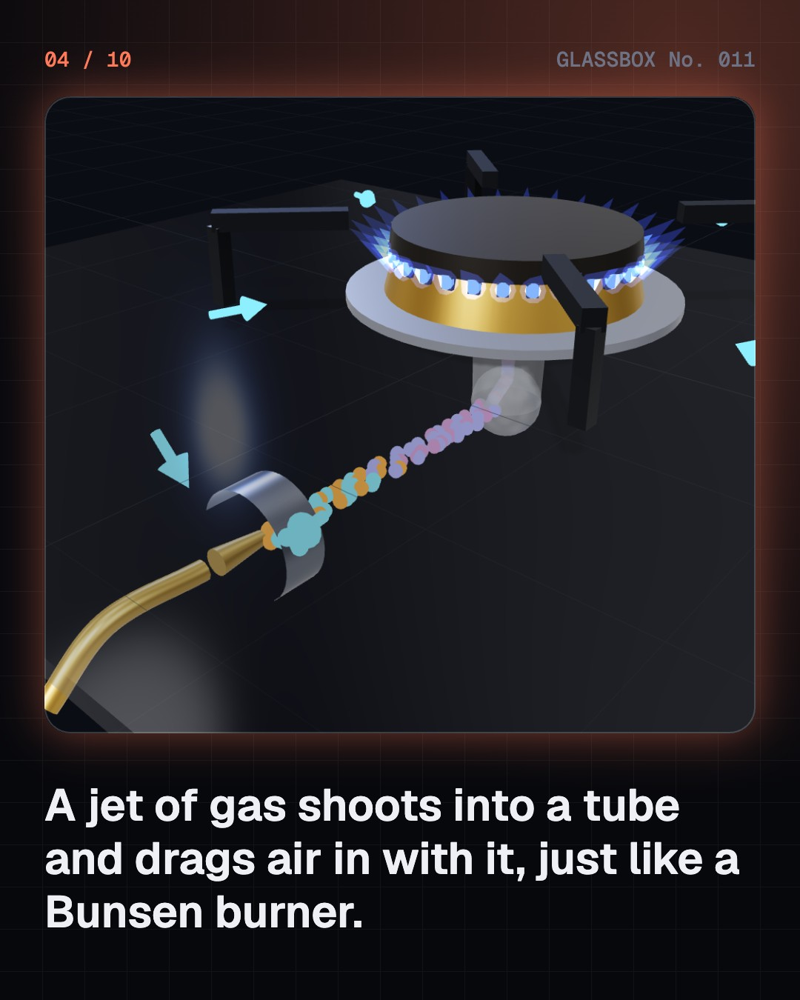

<!-- glassbox:start -->
<!-- Generated from glassbox.json by the Glassbox hub (npm run readme -- chimneyclear). Edit glassbox.json, not this block. -->
<p align="center"><a href="https://glassbox-production-fd52.up.railway.app/e/chimneyclear/"></a></p>

<h1 align="center">ChimneyClear</h1>

<p align="center"><b>How do a kitchen chimney and gas hob work?</b><br>A spark of 14,000 volts, a jet of gas that drags in its own air, and a hood that catches smoke it can barely suck. Take an Indian kitchen's gas stove and chimney apart in 3D and see why a good flame is blue.</p>

<p align="center"><a href="https://glassbox-production-fd52.up.railway.app/chimneyclear/"><b>▶ Play with it</b></a> &nbsp;·&nbsp; <a href="https://glassbox-production-fd52.up.railway.app/e/chimneyclear/">Read the 60-second explainer</a> &nbsp;·&nbsp; <a href="https://glassbox-production-fd52.up.railway.app/chimneyclear/glassbox/reel.mp4">Watch the 40-second video</a></p>

<p align="center">
  <a href="https://glassbox-production-fd52.up.railway.app/e/chimneyclear/"></a>
  <a href="https://glassbox-production-fd52.up.railway.app/e/chimneyclear/"></a>
  <a href="LICENSE"></a>
  <a href="LICENSE-CONTENT.md"></a>
  <a href="#privacy"></a>
</p>

## In 60 seconds

1. **Gas from a cylinder, smoke out through a duct.** LPG waits as a liquid in a 14.2 kg cylinder at about 5 bar. A regulator lets it out at a gentle 29 millibar, a hose carries it to the stove, and a valve behind each knob feeds a brass burner. Above, a chimney's blower pulls smoky air through grease filters and out through a duct.
2. **Why a good flame is blue.** The gas shoots from a tiny injector into a mixing tube and drags air in with it, the Bunsen principle. With about half the air it needs premixed, the flame burns clean and blue at up to about 1,900 °C. Starved of air, unburnt carbon glows yellow as soot and the flame makes carbon monoxide.
3. **Thousands of volts to light it, millivolts to keep it safe.** The igniter needs about 14,000 volts to make a spark jump a 4 mm gap. On stoves with a flame-failure device, a thermocouple in the flame makes about 28 millivolts to power a magnet that holds the gas valve open. If the flame dies, the voltage falls and a spring shuts the gas off.
4. **The chimney doesn't suck the smoke up.** At the pan, 70 cm below the hood, a chimney's suction is only about 0.05 m/s. The smoke rises by itself in a hot plume at about 1 m/s. The hood has to be low and wide enough to swallow that plume before a draught pushes it out from under the edge.
5. **Oil can't turn corners.** A baffle filter forces the air to zig-zag. Air follows easily, but oil droplets are about 750 times denser, so they keep going straight and hit the steel, then drain into the oil collector. Droplets smaller than a few microns slip through.
6. **The number on the box is not the air you get.** Rated suction is measured with nothing in the way. The filter, a narrow duct, bends and a shut window all push back, so a 1,200 m³/h chimney often moves half to two thirds of that. Where the fan curve meets the duct's system curve is the airflow you really get.

## Words worth knowing

| Term | Meaning |
|---|---|
| **LPG** | Liquefied petroleum gas: mostly propane and butane, stored as a liquid under pressure in a cylinder. |
| **Regulator** | The valve on the cylinder that lowers the gas pressure to a steady 29 millibar for the stove. |
| **Primary air** | Air mixed with the gas inside the burner before it reaches the flame. |
| **Bunsen principle** | A fast jet of gas drags the surrounding air into a tube with it, premixing fuel and air. |
| **Carbon monoxide** | A poisonous, invisible gas made when fuel burns without enough oxygen. |
| **Thermocouple** | Two different metals joined at a tip that make a small voltage when the tip is heated. |
| **Flame-failure device** | A thermocouple and magnet valve that shut off the gas if the flame goes out. |
| **Inertial impaction** | Catching particles by turning the air so sharply that they cannot follow and hit a surface. |
| **System curve** | How much pressure a duct needs for each airflow. Where it meets the fan curve is the real airflow. |

## A short history

**9,000 years from a hole in the roof above an open fire to a blue gas flame under a humming hood in hundreds of millions of kitchens.**

- **7000 BCE** · A way out through the roof (People of Çatalhöyük, Çatalhöyük, Anatolia (today Turkey))
- **1185** · Chimneys arrive in Europe (Castle builders, Conisbrough Castle, Yorkshire, England)
- **1796** · Count Rumford fixes the smoky fireplace (Benjamin Thompson, Count Rumford, London, England)
- **1826** · A gas stove you could buy (James Sharp, Northampton, England)
- **1855** · The Bunsen burner (Robert Bunsen and Peter Desaga, University of Heidelberg, Germany)
- **1912** · Gas in a bottle (Walter O. Snelling, USA)
- **1933** · The range hood becomes a product (Vent-A-Hood, Dallas, Texas, USA)
- **1965** · Indane lights up Kolkata (Indian Oil Corporation, Kolkata, India)

The full story, with 29 moments, charts, people and 43 sources: [glassbox.how/e/chimneyclear/history](https://glassbox-production-fd52.up.railway.app/e/chimneyclear/history/). The data lives in [`history.json`](history.json).

## Video and slides

Made with the Glassbox studio from this box's storyboard (`window.glassbox.director`). Free to reuse under CC BY 4.0.

<a href="https://glassbox-production-fd52.up.railway.app/chimneyclear/glassbox/video.mp4"></a>

<p><a href="glassbox/slide-1.jpg"></a> <a href="glassbox/slide-2.jpg"></a> <a href="glassbox/slide-3.jpg"></a> <a href="glassbox/slide-4.jpg"></a></p>

| File | What | Size |
|---|---|---|
| [`glassbox/reel.mp4`](https://glassbox-production-fd52.up.railway.app/chimneyclear/glassbox/reel.mp4) | Reel / Short, with captions and soundtrack | 1080×1920 |
| [`glassbox/video.mp4`](https://glassbox-production-fd52.up.railway.app/chimneyclear/glassbox/video.mp4) | YouTube video, with captions and soundtrack | 1920×1080 |
| `glassbox/slide-1…10.jpg` | Instagram carousel | 1080×1350 |
| `glassbox/thumb.jpg` | YouTube thumbnail | 1280×720 |
| `glassbox/cover.jpg` | Share card and repo social preview | 1200×630 |
| [`glassbox/history-reel.mp4`](https://glassbox-production-fd52.up.railway.app/chimneyclear/glassbox/history-reel.mp4) | “History in 10 moments” Reel / Short | 1080×1920 |
| `glassbox/history-slide-*.jpg` | History carousel | 1080×1350 |
| `glassbox/post.json` | Post copy and schedule used by the publish kit | |

## Privacy

This box has no accounts and no ads, and it ships its own fonts and libraries. When you run it yourself it sends nothing anywhere. On glassbox.how, the site's `/bar.js` also loads Glassbox's analytics: **Google Analytics** to count visits (it asks first in the EU, UK and Switzerland, and stays off when your browser sends Global Privacy Control or Do Not Track) and **ClickTrust** to detect bots.

It remembers a few things **in your own browser only**, and never sends them anywhere:

| Browser storage key | What it holds |
|---|---|
| `chimneyclear.v1` | Which chapters you have opened, your best quiz scores, and sound on or off. |

Exactly what each one sees is at [glassbox.how/privacy](https://glassbox-production-fd52.up.railway.app/privacy/).

## Licences

- **Code:** [MIT](LICENSE). Use it, change it, ship it.
- **Explanations, text, images and videos** (`glassbox.json`, `glassbox/`): [CC BY 4.0](LICENSE-CONTENT.md). Credit “Glassbox, glassbox.how/e/chimneyclear”.
- **Third-party parts** keep their own licences: [three.js](https://threejs.org) (MIT), [Geist, Instrument Serif](https://openfontlicense.org) (SIL OFL 1.1).
- The Glassbox name and logo aren't covered by either licence. See the [terms](https://glassbox-production-fd52.up.railway.app/terms/).

Found a mistake? [Open an issue](https://github.com/bdeeps/chimneyclear/issues). Corrections happen in public.
<!-- glassbox:end -->

## Run it

It's plain HTML, CSS and JavaScript. No build step and no dependencies. Run locally, it contacts no other website.

```bash
python3 -m http.server 8000
```

Three.js and the fonts ship in `vendor/` and `fonts/`, so it also works offline.

Then open http://localhost:8000.

## How it's built

| File | What |
|---|---|
| `index.html`, `css/app.css` | The page and its styles |
| `js/app.js`, `js/stage.js`, `js/ui.js`, `js/kit.js` | The shared Glassbox 3D engine: chapters, 3D stage, controls, quiz, video director |
| `js/chapters/*.js` | One file per chapter: the 3D model, controls, text, key terms, quiz and video scenes |
| `js/kitchen.js` | The shared physics and models: LPG and flame numbers, the plume and hood-capture model, droplet (Stokes) filter physics, fan and duct curves, and 3D builders for the cylinder, regulator, stove, burners, flames and chimney |
| `glassbox.json` | Title, question, explainer beats, key terms, browser storage and credits shown on glassbox.how |
| `reel` in each chapter | The storyboard the Glassbox studio records into short videos |
| `glassbox/` | The published video, slides, thumbnail and post copy |
| `fonts/`, `vendor/three/` | Self-hosted Geist and Instrument Serif (SIL OFL 1.1) and three.js (MIT) |
